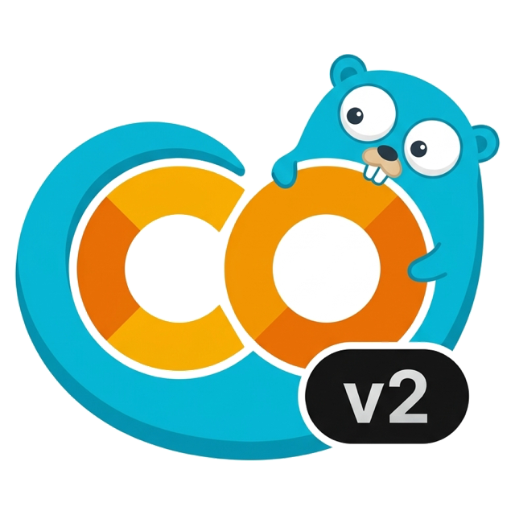
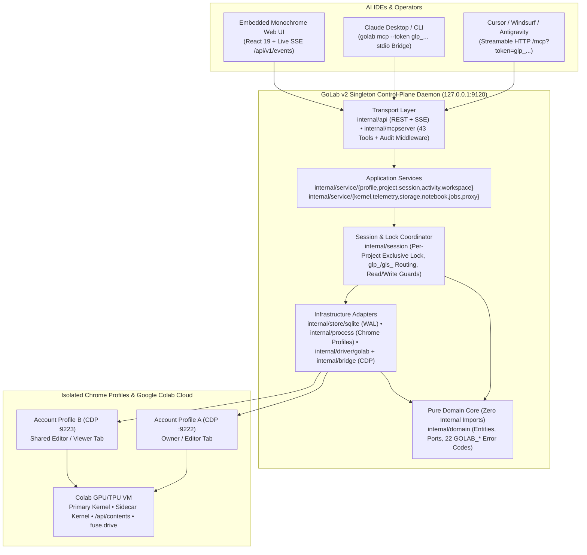

<div align="center">
  
  <h1>GoLab v2</h1>
  <p><b>Multi-Account Control Plane, Direct-Tunnel MCP Server & Monochrome Observability UI for Google Colab</b></p>

  [](https://github.com/hoangnecon/golabv2/releases)
  [](https://github.com/hoangnecon/golabv2/actions/workflows/ci.yml)
  [](https://go.dev/)
  [](GOLAB_AGENT_HARNESS.md)
  [](LICENSE)
  [](https://github.com/hoangnecon/golabv2/pulls)

  <p>
    <a href="#-quick-start">Quick Start</a> •
    <a href="#-architecture--layered-design">Architecture</a> •
    <a href="#-golab-v1-vs-golab-v2">v1 vs v2</a> •
    <a href="#-43-canonical-mcp-tools">43 MCP Tools</a> •
    <a href="#-concrete-mcp-payload-examples">Examples</a> •
    <a href="#-6-gate-verification-suite">Verification Gates</a>
  </p>
</div>

---

**GoLab v2** is a ground-up Clean Architecture rewrite of [GoLab v1](https://github.com/hoangnecon/golab) — a compiled, zero-CGO Go **Control-Plane Daemon and Model Context Protocol (MCP) Server** that bridges local AI IDEs (**Cursor**, **Claude Desktop**, **Windsurf**, **Gemini Code Assist**, **Antigravity**) directly to remote **Google Colab** GPU/TPU runtimes.

Instead of injecting fragile WebSocket URL parameters into a single browser tab or queueing file operations behind busy training cells, **GoLab v2** attaches directly to isolated Chrome Account Profiles via **Chrome DevTools Protocol (CDP)**, Colab's authenticated **Tunnel XHR Gateway (`kernel.getKernelXhr()`)**, and **Sidecar Python 3 Kernels** — governed by a singleton local daemon with an embedded **Pure Neutral Monochrome (`R = G = B`) Observability Web UI**.

---

## ✨ Why GoLab v2?

- **Singleton Control-Plane Architecture (`127.0.0.1:9120`)** — One native Go binary (`golab`) coordinates SQLite WAL state (`~/.golab/state.db`), `/api/v1/*` REST governance, `/api/v1/events` live typed SSE, `/mcp` Streamable HTTP, a `golab mcp` `stdio`⇄HTTP auto-spawning bridge, and the embedded Monochrome UI.
- **Multi-Account Quota Rotation & Per-Project Exclusive Lock** — Share one canonical Colab Notebook across multiple Google Accounts (`1 Project = 1 Notebook`, `1 Session = Project × Account`). GoLab v2 enforces a **Single-Account Exclusive Lock** per Project so two accounts never overwrite the same `.ipynb`, and automatically flushes `SaveNotebook` + closes the previous account's tab on lock switch.
- **Zero-Downtime `glp_` / `gls_` Token Routing** — Bind your IDE once to a **Project Token (`glp_<32hex>`)**. When an account runs out of Compute Units, switch the lock in the GoLab UI — every subsequent MCP tool call seamlessly routes to the newly locked account without restarting your IDE.
- **Non-Blocking Out-of-Band I/O & Sidecar Execution** — Read/write checkpoints in **20–50ms** via `/api/contents/*` (`colab-fileshim.py`) and run Python diagnostics or detached background jobs (`/tmp/.golab_jobs/`) via **Sidecar Kernels (`POST /api/kernels`)** while your primary notebook cell trains at 100% GPU utilization.
- **Ground-Truth Google Drive FUSE Guardrails** — Verifies real `fuse.drive` entries in `/proc/mounts`, blocks unmounted local shadow directories (`GOLAB_DRIVE_LOCAL_SHADOW_DIR`), auto-mounts sole-authored notebooks (`dfs_persistent`), and surfaces structured OAuth popup metadata (`drive_auth_pending`) on shared notebooks.
- **100% Pure Monochrome (`R = G = B`) Observability UI** — Zero `setInterval` polling, zero Colab-duplicating buttons, geometric glyph state indicators (`●`, `◎`, `○`, `△`, `▪`), live SSE updates, and a split-pane **JSON Payload Inspector** capturing 100% of MCP tool requests, responses, latencies, and errors.

---

## 📊 GoLab v1 vs GoLab v2

| Capability | GoLab v1 (`hoangnecon/golab`) | GoLab v2 (`hoangnecon/golabv2`) |
| :--- | :--- | :--- |
| **Transport Engine** | Ephemeral `?mcpProxyPort=` WebSocket proxy | **Direct Chrome CDP + Authenticated `kernel.getKernelXhr()` + Sidecar Kernels** |
| **Daemon Topology** | Per-IDE process (port collisions across windows) | **Singleton Daemon (`127.0.0.1:9120`) + Unlimited Concurrent HTTP & `stdio` Clients** |
| **Multi-Account & Quota** | Single browser tab, no quota visibility | **Isolated Chrome Profiles + Live CCU Balance, Burn Rate (`CU/h`) & GPU/TPU Eligibility** |
| **Notebook Concurrency** | Unprotected | **Per-Project Single-Account Exclusive Lock + Auto `SaveNotebook` Flush on Switch** |
| **Token Routing** | Single static `COLAB_TOKEN` | **Project Token (`glp_...`) Dynamic Lock Routing + Session Token (`gls_...`) Pinning** |
| **MCP Tool Surface** | 23 tools | **43 Canonical Tools** with uniform `ResponseEnvelope` & 22 typed `GOLAB_*` error codes |
| **File I/O During Training** | Blocked when kernel is busy | **Non-Blocking 20–50ms `/api/contents/*` XHR** (zero training interruption) |
| **Google Drive Safety** | Manual mount only; susceptible to shadow dirs | **Two-Path Automated Mount + `/proc/mounts` `fuse.drive` Ground-Truth Guardrail** |
| **Observability UI** | None | **Embedded React 19 Pure Monochrome (`R = G = B`) SSE Control Plane & JSON Inspector** |
| **Quality & CI Gates** | Unit tests + `go vet` | **6 Automated Gates** (Go AST Clean Arch, `-race`, Go↔TS Contract, `R=G=B` Lint, Embed, Real Chrome E2E) |

---

## 🏛️ Architecture & Layered Design

GoLab v2 enforces strict inward-pointing **Clean Architecture** boundaries (verified on every build by **Gate 1** in [`internal/arch_test.go`](internal/arch_test.go)):



### Repository Layer Map

| Layer | Path | Responsibility |
| :--- | :--- | :--- |
| **CLI Composition Root** | `cmd/server` | Subcommands (`daemon`, `ui`, `mcp`, `version`), OS signal lifecycle, embedded UI wiring (`internal/app`). |
| **Pure Domain Core** | `internal/domain` | Zero internal imports. Canonical entities (`Profile`, `Project`, `Session`, `ToolCallRecord`), `RuntimeDriver` port, and 22 `GOLAB_*` errors. |
| **Persistence (`SQLite WAL`)** | `internal/store/sqlite` | Pure-Go `modernc.org/sqlite` WAL store (`~/.golab/state.db`), foreign-key enforcement, atomic lock transitions, and schema migrations. |
| **Browser & CDP Bridge** | `internal/process`, `internal/bridge` | Isolated Chrome `--user-data-dir` process lifecycle and concurrent multiplexed Chrome DevTools Protocol WebSocket client. |
| **Colab Runtime Driver** | `internal/driver/golab` | Live-verified JS/CDP probes for identity, CCU quota, FUSE Drive verification/mount, kernel XHR tunnel, and sidecar Python kernels. |
| **Session Coordinator** | `internal/session` | Per-Project Exclusive Lock state machine, `SaveNotebook` flush + tab detach on `force_switch`, `glp_`/`gls_` token resolution, and typed `EventBus`. |
| **Domain Services** | `internal/service/**` | Business orchestration across governance (`Profile`, `Project`, `Session`, `Activity`) and Colab runtime (`kernel`, `telemetry`, `storage`, `notebook`, `jobs`, `proxy`). |
| **REST/SSE & MCP Transports** | `internal/api`, `internal/mcpserver` | `/api/v1/*` JSON controllers, `/api/v1/events` SSE stream, `/mcp` Streamable HTTP handler, `stdio`⇄HTTP bridge, and outermost audit capture middleware. |
| **Monochrome Web UI** | `ui/src/{shared,data,features}` | React 19 + TypeScript + Tailwind CSS strict `R = G = B` monochrome interface embedded directly into the Go binary (`ui/dist`). |

---

## 🚀 Quick Start

### Option 1: Pre-Compiled Single Binary (macOS, Linux, Windows)

Download the pre-built binary (with the production Web UI already embedded) from the [**Releases Page**](https://github.com/hoangnecon/golabv2/releases):

```bash
# macOS (Apple Silicon) example:
chmod +x ./golab-darwin-arm64
mv ./golab-darwin-arm64 /usr/local/bin/golab

# Start the Control-Plane Daemon and open the Monochrome UI at http://127.0.0.1:9120
golab ui
```

### Option 2: Build from Source

**Prerequisites:** [Go 1.26+](https://go.dev/dl/), [Node.js 22+ & pnpm](https://pnpm.io/), and **Google Chrome**.

```bash
git clone https://github.com/hoangnecon/golabv2.git
cd golabv2

# Typecheck UI, enforce R=G=B design rules, build Vite bundle, and embed into ./bin/golab
make build

# Launch Control-Plane Daemon + open Web UI
./bin/golab ui
```

### 3-Step Workspace Onboarding (`http://127.0.0.1:9120`)

1. **Connect Account(s) (`#/accounts`)**: Launch an isolated Chrome profile and sign into your Google Account once. GoLab automatically extracts account identity, live **Compute Units (`CCU`)**, burn rate (`CU/h`), and GPU/TPU eligibility.
2. **Create a Project & Lock an Account (`#/projects`)**: Click **New project**, paste your Colab Notebook URL (`https://colab.research.google.com/drive/...`), attach one or more Google Accounts as sessions, and click **Lock** on the active Account.
3. **Wire Your AI IDE (`MCP Config`)**: Click **MCP Config** on the Project header to copy your ready-to-paste **Project Token (`glp_...`)** snippet:

#### Mode A — Streamable HTTP (Recommended for Cursor, Windsurf, Antigravity)
```json
{
  "mcpServers": {
    "golab": {
      "url": "http://127.0.0.1:9120/mcp?token=glp_replace_with_your_project_token"
    }
  }
}
```

#### Mode B — Auto-Spawning `stdio` Bridge (Claude Desktop, CLI Agents)
```json
{
  "mcpServers": {
    "golab": {
      "command": "/usr/local/bin/golab",
      "args": ["mcp", "--token", "glp_replace_with_your_project_token"]
    }
  }
}
```

#### Mode C — Direct `go run` Cloud Module (`stdio` Bridge)
```json
{
  "mcpServers": {
    "golab": {
      "command": "go",
      "args": ["run", "github.com/hoangnecon/golabv2/cmd/server@latest", "mcp", "--token", "glp_replace_with_your_project_token"],
      "env": {
        "GOPROXY": "direct"
      }
    }
  }
}
```

---

## ⚙️ CLI Reference & Environment Variables

```bash
golab ui     [--addr 127.0.0.1:9120] [--db ~/.golab/state.db]              # Start daemon & open Web UI
golab daemon [--addr 127.0.0.1:9120] [--db ~/.golab/state.db] [--headless] # Run daemon in background/foreground
golab mcp    [--addr 127.0.0.1:9120] [--token glp_...]                     # Auto-spawn daemon & bridge stdio <-> /mcp
golab version                                                              # Print version (v2.0.0)
```

| Environment Variable | Description | Default |
| :--- | :--- | :--- |
| `GOLAB_ADDR` | Bind/connect address for the singleton Control-Plane Daemon. | `127.0.0.1:9120` |
| `GOLAB_DB_PATH` | Path to the SQLite WAL state database (`0600` permissions). | `~/.golab/state.db` |
| `GOLAB_SESSION_TOKEN` | Default `glp_<32>` Project Token or `gls_<32>` Session Token for `golab mcp`. | `""` |
| `CHROME_PATH` | Explicit path to Google Chrome / Chromium binary. | Auto-detected |

---

## 🧰 43 Canonical MCP Tools

Every tool returns a uniform JSON `ResponseEnvelope` (`status`, `data`, `error`, `metadata`) and works out-of-the-box with **all** MCP clients without requiring `notifications/tools/list_changed`. Full parameter schemas and agent operating rules are documented in [**`GOLAB_AGENT_HARNESS.md`**](GOLAB_AGENT_HARNESS.md).

### 1. Session & Account Governance (4 tools)
| Tool | Description |
| :--- | :--- |
| **`colab_get_session_context`** | Returns the resolved Project, Account Profile, locked Session state, Notebook URL, permission (`owner`/`editor`/`view_only`), and CCU summary. |
| **`colab_list_all_sessions`** | Lists all Projects, Account Profiles, and Notebook Sessions with their Per-Project Lock status and connection states. |
| **`colab_open_session_tab`** | Ensures the Account's Chrome profile is running and opens/focuses the Colab Notebook tab, refreshing identity and permissions. |
| **`colab_get_account_quota`** | Queries live Google Colab Compute Units balance, hourly burn rate (`CU/h`), GPU/TPU eligibility, and active VM assignments across the account. |

### 2. Runtime & Kernel Lifecycle (8 tools)
| Tool | Description |
| :--- | :--- |
| **`colab_get_kernel_status`** | Real-time status of all Colab kernels on the VM (`idle`, `busy`, `starting`), active session ID, and connection count. |
| **`colab_connect_runtime`** | Connects the notebook to a hosted Google Colab VM runtime and waits until the Python kernel is ready. |
| **`colab_disconnect_runtime`** | Unassigns and releases the active Colab VM runtime (confirming Colab's disconnect dialog) to stop Compute Unit burn. |
| **`colab_interrupt_kernel`** | Sends an immediate `SIGINT` interrupt to stop a running cell while preserving variables in Python RAM. |
| **`colab_restart_kernel`** | Restarts the Python kernel, clearing stalled processes and freeing GPU VRAM. |
| **`colab_get_available_accelerators`** | Lists available CPU, GPU (`T4`, `L4`, `A100`, `G4`), and TPU (`V5E1`, `V6E1`) accelerators plus High-RAM options. |
| **`colab_set_accelerator`** | Configures the notebook's hardware accelerator and High-RAM setting via Colab runtime preferences. |
| **`colab_exec_python`** | Executes silent out-of-band Python code without adding cells; automatically routes to a **Sidecar Kernel** when the primary cell is busy. |

### 3. Hardware Telemetry & Two-Path Google Drive FUSE (5 tools)
| Tool | Description |
| :--- | :--- |
| **`colab_get_hardware_telemetry`** | Instant non-blocking VM telemetry via `/api/colab/resources`: GPU VRAM, utilization, system RAM, and SSD disk usage. |
| **`colab_get_compute_units`** | Fetches live Colab Compute Units balance, hourly burn rate, and eligible GPUs/TPUs via `paidResourceMonitor.fetchCcuInfo()`. |
| **`colab_check_drive_status`** | Verifies ground-truth `fuse.drive` mount in `/proc/mounts` + MyDrive quota, catching unmounted local shadow folders (`corrupted_local_dir`). |
| **`colab_mount_drive`** | Automates Colab's two-path Drive mount: auto-confirms sole-authored `dfs_persistent` dialogs or surfaces `drive_auth_pending` OAuth popup metadata on shared notebooks. |
| **`colab_get_build_info`** | Retrieves Google Colab VM container image release tags and runtime build metadata. |

### 4. Non-Blocking VM SSD & MyDrive Storage (7 tools)
| Tool | Description |
| :--- | :--- |
| **`colab_list_directory`** | Lists files/directories via `/api/contents` (20–50ms even during GPU training), enforcing FUSE verification on `content/drive/...` paths. |
| **`colab_stat_path`** | Inspects existence, type, size, writability, and modification timestamp without downloading file contents. |
| **`colab_read_file`** | Reads text or base64 binary files from VM SSD or mounted Google Drive without blocking the training kernel. |
| **`colab_write_file`** | Atomically creates or overwrites text or base64 files on VM SSD or verified Google Drive FUSE mount. |
| **`colab_create_directory`** | Creates a directory on Colab VM SSD or mounted Google Drive. |
| **`colab_move_file`** | Renames or moves a file or directory on Colab VM SSD or mounted Google Drive. |
| **`colab_delete_file`** | Deletes a file or directory on Colab VM SSD or mounted Google Drive. |

### 5. Notebook DOM & Precision Cell Editing (9 tools)
| Tool | Description |
| :--- | :--- |
| **`colab_get_notebook_outline`** | Compact structural outline of all cells (`index`, `cell_id`, `cell_type`, `line_count`, and first-line summary). |
| **`colab_get_cells`** | Fetches code and markdown cells in an index range, optionally including outputs. |
| **`colab_get_cell_with_lines`** | Returns a cell's source annotated with 1-based line numbers alongside raw source and outputs. |
| **`colab_search_cells`** | Case-insensitive substring search across all cells with matching cell IDs, indices, and 1-based line numbers. |
| **`colab_add_cell`** | Inserts a new `code` or `markdown` cell at a 0-based index (enforces Owner/Editor permission). |
| **`colab_update_cell`** | Replaces the full content of an existing cell by `cell_id` (enforces Owner/Editor permission). |
| **`colab_edit_cell_lines`** | Surgically replaces a 1-based inclusive line range `[start_line, end_line]` inside a cell without rewriting unchanged lines. |
| **`colab_move_cell`** | Moves an existing cell to a new 0-based index position in the notebook. |
| **`colab_delete_cell`** | Deletes a cell from the notebook by `cell_id` (enforces Owner/Editor permission). |

### 6. Cell Execution, Outputs & Persistence (5 tools)
| Tool | Description |
| :--- | :--- |
| **`colab_run_code_cell`** | Schedules execution of a code cell by `cell_id` on the Colab runtime. |
| **`colab_run_all_cells`** | Schedules sequential execution of all code cells in the notebook. |
| **`colab_get_running_cells`** | Non-blocking inspection of currently executing cells, elapsed seconds, and streaming `stdout` previews. |
| **`colab_get_cell_output`** | Extracts structured `stdout`, `stderr`, tracebacks, and PNG plot counts, optionally exporting base64 PNG plots to `save_images_dir`. |
| **`colab_save_notebook`** | Flushes all notebook edits and outputs to Google Drive (`Ctrl+S` equivalent; enforces Owner/Editor permission). |

### 7. Out-of-Band Background Jobs & Port Proxy (5 tools)
| Tool | Description |
| :--- | :--- |
| **`colab_start_background_job`** | Starts a detached background process on the Colab VM (`/tmp/.golab_jobs/`) via sidecar kernel while primary cells are busy. |
| **`colab_poll_background_job`** | Polls PID liveness, exit code, and log tail lines of a background job without interrupting training. |
| **`colab_kill_background_job`** | Sends `SIGTERM`/`SIGKILL` to a background job process group and returns its final status. |
| **`colab_proxy_forward`** | Forwards an HTTP request to an internal port on the Colab VM through Colab's `/_proxy/<port>/` gateway. |
| **`colab_get_proxy_url`** | Retrieves the external HTTPS proxy URL and bearer token for an exposed port on the Colab VM. |

---

## 📚 Concrete MCP Payload Examples

### 1. Querying Live Compute Units & Hardware Eligibility (`colab_get_compute_units`)
```json
{
  "status": "success",
  "data": {
    "assignments_count": 1,
    "balance": 15.25,
    "consumption_rate_hourly": 0.08,
    "formatted_balance": "15.25",
    "tier": "pro",
    "eligible_gpus": ["G4", "A100", "L4", "T4"],
    "ineligible_gpus": ["H100"],
    "eligible_tpus": ["V6E1", "V5E1"]
  },
  "metadata": {
    "latency_ms": 41,
    "project_id": "a1c8b153-ee69-43d1-b6e6-ad0c05cfa8da",
    "session_id": "18dc62c5-965f-4d3d-8b2c-c1f9c1579266",
    "profile_id": "default",
    "kernel_state": "busy",
    "permission": "owner",
    "timestamp": "2026-11-11T04:00:00Z"
  }
}
```

### 2. Ground-Truth Shadow Directory Protection (`colab_write_file`)
If `/content/drive/MyDrive` exists as an unmounted local folder on ephemeral SSD (`fuse.drive` absent in `/proc/mounts`), GoLab v2 blocks data loss before a single byte is written:
```json
{
  "status": "error",
  "error": {
    "code": "GOLAB_DRIVE_LOCAL_SHADOW_DIR",
    "message": "/content/drive exists on local ephemeral SSD without an active fuse.drive mount",
    "hint": "Remove or rename the local /content/drive directory first, then call colab_mount_drive."
  },
  "metadata": {
    "latency_ms": 28,
    "project_id": "a1c8b153-ee69-43d1-b6e6-ad0c05cfa8da",
    "session_id": "18dc62c5-965f-4d3d-8b2c-c1f9c1579266",
    "permission": "editor",
    "timestamp": "2026-11-11T04:01:12Z"
  }
}
```

---

## 🛡️ 6-Gate Verification Suite

Every change in GoLab v2 must pass `./scripts/verify.sh` (`make verify`), enforced automatically on Ubuntu & macOS in GitHub Actions ([`.github/workflows/ci.yml`](.github/workflows/ci.yml)):

```bash
make verify
```

| Gate | Command / Script | What It Enforces |
| :---: | :--- | :--- |
| **Gate 1** | `go test ./internal -run TestCleanArchitectureImports` | Zero inward Clean Architecture AST import violations across `internal/**` and `cmd/**`. |
| **Gate 2** | `go test -race -count=1 ./internal/... ./cmd/...` | Full unit & integration test suite under the Go race detector in isolated `t.TempDir()` stores. |
| **Gate 3** | `node scripts/check-api-contract.mjs` | Static verification of all **27 REST/SSE server routes** and **11 DTO contracts** between Go and TypeScript. |
| **Gate 4** | `(cd ui && pnpm run check:design)` | 100% pure neutral monochrome (`R = G = B`) token check, zero `setInterval` polling, and `shared`/`data`/`features` boundaries. |
| **Gate 5** | `tsc --noEmit` + `vite build` + `go build ./cmd/server` | Zero TypeScript errors, production UI bundle build, and Go binary `embed.FS` verification. |
| **Gate 6** | `go test -v ./e2e/...` | Compiled `golab` daemon + 2-Account Mock CDP + 3 concurrent HTTP/`stdio` MCP clients + real `--headless=new` Chrome `getComputedStyle` `R === G === B` walk across 2,600+ live DOM nodes. |

---

## 🤝 Contributing

1. Fork the repository and create a feature branch (`git checkout -b feat/your-feature`).
2. Read [`GOLAB_AGENT_HARNESS.md`](GOLAB_AGENT_HARNESS.md) and [`ui/DESIGN.md`](ui/DESIGN.md) before modifying runtime tools or UI components.
3. Run `make verify` locally and ensure all **6 gates** pass with zero warnings.
4. Open a Pull Request with reproducible verification output.

---

## 📜 License

Licensed under the [Apache License 2.0](LICENSE).
